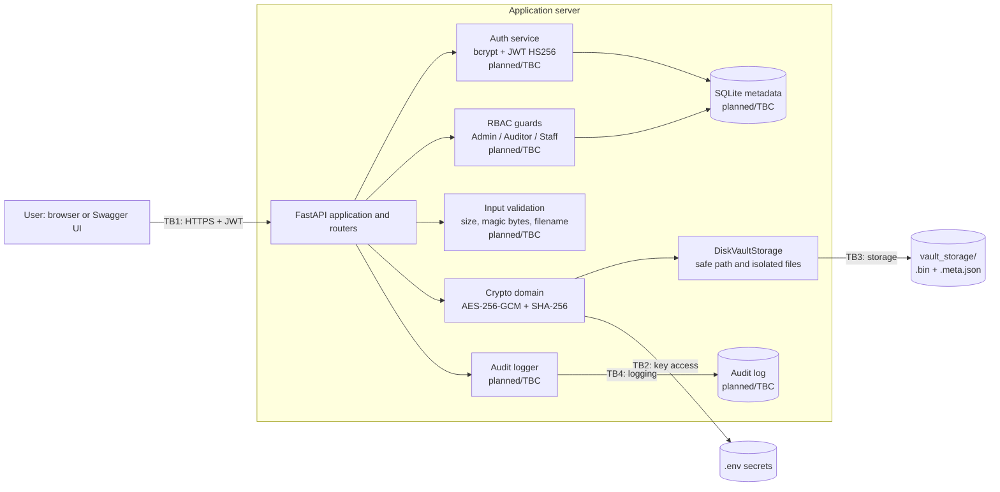
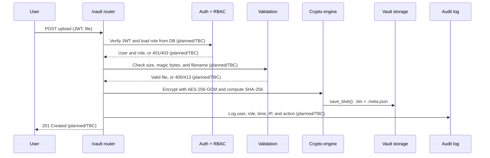
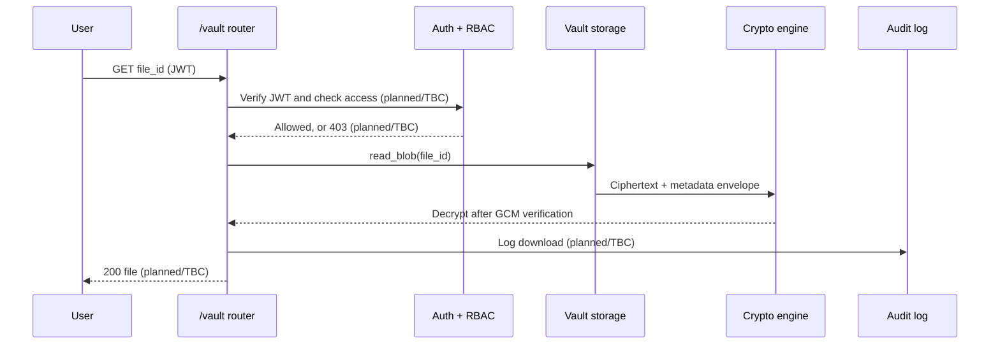

# Architecture — Role-Based Secure Financial Document Vault

| Field | Value |
|---|---|
| Document owner | OhUk Kwon (Lead System Architect & Core Developer) |
| Reviewer | David Williams (Threat Modeling & Technical Documentation Lead) |
| Current version | **v0.1 — Draft** |
| Last updated | 2026-10-19 |
| Linked documents | [`THREAT_MODEL.md`](THREAT_MODEL.md) v0.5 · [`TEST_MATRIX.md`](TEST_MATRIX.md) v0.1 · [`DOCUMENTATION_GUIDE.md`](DOCUMENTATION_GUIDE.md) v0.5 |
| Code baseline | `main` at commit `a8c2a38432f6df47e7caf997171646b6eccd1d09` |

> Items marked **TBC** require confirmation from the code owner before the final report export. This document distinguishes implemented repository components from planned application features.

---

## 1. Overview

The intended vault is a FastAPI backend that allows authenticated users to upload and download financial documents according to a three-tier role model. The current repository implements the cryptographic and secure-storage foundations: AES-256-GCM encryption, SHA-256 integrity hashing, path-traversal defenses, and separated ciphertext/metadata persistence.

Configuration hardening is documented for the merged baseline: encryption-key validation, JWT-secret validation, HS256-only configuration, and bounded access-token lifetime. Authentication, role-based authorization, audit logging, and complete API delivery remain planned or TBC unless marked as implemented in the source code and corresponding tests. Trust boundaries TB1–TB4 are defined in [`THREAT_MODEL.md`](THREAT_MODEL.md) §4.

## 2. Technology Stack

| Layer | Technology | Current status / notes |
|---|---|---|
| API | FastAPI, Swagger UI | Application scaffold exists; complete `/auth`, `/vault`, and `/audit` delivery is TBC. `/docs` is exposed for the demo only (F-06). |
| Authentication | bcrypt password hashing; JWT signed with HS256 | Full auth module is planned/TBC. Configuration enforces HS256 and short token-lifetime bounds. |
| Authorization | Three-tier RBAC: Administrator, Compliance Auditor, General Staff | Planned/TBC. Role checks must be enforced server-side on every protected request. |
| Encryption | AES-256-GCM in `app/domains/crypto/aes_engine.py` | Implemented. AES-GCM authenticates ciphertext and rejects modified payloads. |
| Integrity | SHA-256 with constant-time comparison in `app/domains/crypto/hasher.py` | Implemented. HMAC protection of stored hashes remains planned for T2. |
| Metadata model | `EncryptedEnvelope` in `app/domains/vault/models.py` | Implemented for vault-file metadata. Full SQLite metadata integration is TBC. |
| File store | `vault_storage/` through `DiskVaultStorage` | Implemented. Stores `{file_id}.bin` ciphertext separately from `{file_id}.meta.json` metadata. |
| Audit log | Append-only, hash-chained security-event log | Planned/TBC. Do not describe this as implemented until the logger and verification routine exist. |
| Secrets and configuration | `.env`, `.env.example`, `setup.bat`, `app/config.py` | Startup validation and setup guardrails are implemented in the merged security-hardening baseline. |
| Dependency wiring | `app/dependencies.py` | Complete production wiring is TBC. |

## 3. Components



| Component | Code location | Responsibility | Status |
|---|---|---|---|
| FastAPI app and configuration | `app/main.py`, `app/config.py` | Application setup, settings, and secret loading | Scaffold / TBC |
| Crypto engine | `app/domains/crypto/aes_engine.py` | AES-256-GCM encryption and decryption | Implemented |
| Integrity hasher | `app/domains/crypto/hasher.py` | SHA-256 hashing and constant-time digest comparison | Implemented |
| Crypto contracts | `app/domains/crypto/protocols.py` | Interfaces for cipher and hash implementations | Implemented |
| Vault models | `app/domains/vault/models.py` | Validated encrypted-file metadata envelope | Implemented |
| Vault storage contract | `app/domains/vault/protocols.py` | Storage and safe-path interface | Implemented |
| Vault storage adapter | `app/domains/vault/disk_storage.py` | Path confinement, ciphertext persistence, metadata persistence, and reads | Implemented |
| Auth service | `app/domains/auth/` | Password hashing, login, JWT creation, and verification | Planned / TBC |
| RBAC guards | Auth dependencies or route guards | Authorization checks on every protected request | Planned / TBC |
| Input validation | Vault/API route dependencies | File size, type, filename, and request validation | Planned / TBC |
| Audit logger | `app/telemetry/audit_logger.py` | Append-only security-event recording and verification | Planned / TBC |
| Routers | `app/domains/*/router.py` | `/auth`, `/vault`, and `/audit` endpoints | Planned / TBC |
| Composition root | `app/dependencies.py` | Dependency injection and implementation wiring | Planned / TBC |

## 4. Implemented Security Foundations

### 4.1 AES-256-GCM

`AesGcmCipherEngine` requires a 32-byte key. It generates a random 12-byte nonce for each encryption operation and returns the nonce prefixed to the ciphertext and authentication tag. During decryption, an invalid tag raises an error before plaintext is returned.

### 4.2 SHA-256 Integrity Verification

`Sha256Hasher` computes a SHA-256 digest and uses `hmac.compare_digest` for constant-time comparison. This does not prevent an attacker from replacing both a file and its stored digest; HMAC protection and version records remain planned for T2.

### 4.3 Vault Storage Isolation

`DiskVaultStorage` confines paths to its resolved base directory. It rejects null bytes, canonicalizes untrusted names with `Path.name`, resolves the target path, and verifies that the result remains within the vault directory.

```text
vault_storage/{file_id}.bin
vault_storage/{file_id}.meta.json
```

### 4.4 Configuration and Setup Validation

The merged security-hardening baseline documents and tests the following controls:

- The encryption key is URL-safe Base64 and decodes to exactly 32 bytes for AES-256-GCM.
- `JWT_SECRET_KEY` requires at least 32 bytes.
- Only `HS256` is accepted for JWT configuration.
- `ACCESS_TOKEN_EXPIRE_MINUTES` is limited to 1–15 minutes.
- `ENCRYPTION_KEY` is preferred, with legacy `FERNET_SECRET_KEY` supported as a compatibility fallback.
- `python-dotenv` is an explicit dependency for `dotenv.load_dotenv`.
- `setup.bat` is Windows-specific and must not expose generated secret values.

These controls harden configuration but do not constitute a complete authentication, RBAC, audit, or API implementation.

## 5. Key Request Flows

The following flows describe the target application design. Steps marked **planned/TBC** are not represented as complete implementation in the current repository.

### 5.1 Upload



### 5.2 Download



## 6. RBAC Permission Matrix

This matrix is based on the role definitions in [`THREAT_MODEL.md`](THREAT_MODEL.md) §2. Deny by default. Complete route enforcement is planned/TBC and is tested by TC-12 and TC-13 when the relevant modules exist.

| Action | Administrator | Compliance Auditor | General Staff |
|---|---|---|---|
| Create users and assign roles | Planned ✓ | ✗ | ✗ |
| Upload documents | Planned ✓ | ✗ | Planned ✓ for permitted categories |
| Download any document | Planned ✓ | Planned ✓ read-only | ✗ |
| Download documents permitted to own role | Planned ✓ | Planned ✓ | Planned ✓ |
| Delete documents | TBC | ✗ | ✗ |
| View audit log | TBC | Planned ✓ | ✗ |
| Delete or edit audit log entries | ✗ | ✗ | ✗ |
| Change configuration | Planned ✓ | ✗ | ✗ |

Target rules: users are pre-registered by an Administrator, users cannot change their own role, and the role is loaded from the database rather than trusted solely from a JWT claim.

## 7. Security Controls Map

| Control | Component | Threats | Findings | Tests | Current status |
|---|---|---|---|---|---|
| bcrypt hashing, lockout, and generic errors | Auth service | S1 | F-05 | TC-01 | Planned / TBC |
| HS256 fixed in code, strong secret, and short expiry | Configuration/auth | S2, E2 | F-01, F-02, F-07 | TC-02, TC-07, TC-13 | Configuration implemented; full auth-flow tests planned |
| Role reloaded from DB and deny by default | RBAC guards | E1, E2 | — | TC-12, TC-13 | Planned / TBC |
| AES-256-GCM authenticated encryption | Crypto engine | T1, I5 | F-04 | TC-03, TC-15 | Implemented; verification recorded in the test matrix where applicable |
| HMAC-protected integrity hashes | Crypto engine | T2 | — | TC-04 | Planned |
| Safe path resolution and confinement | Vault storage | I2 | F-08 | TC-08 | Verified with passing vault unit tests |
| Separate ciphertext and metadata storage | Vault storage | I5 | F-09 | TC-15 | Verified with passing vault unit tests |
| Parameterized queries / ORM | Database access | T4 | — | TC-14 | Planned / TBC |
| Size limit, rate limiting, and magic-byte allowlist | Input validation | D1, D2 | — | TC-10, TC-11 | Planned / TBC |
| Hash-chained append-only audit log | Audit logger | T3, R1 | — | TC-05, TC-06 | Planned / TBC |
| Keys only in git-ignored `.env`, checked at startup | Configuration | I1, I6 | F-02, F-03, F-04 | TC-07 | Implemented configuration validation; operational secret management remains residual |

## 8. Design Decisions

| ID | Decision | Alternatives considered | Reason | Related |
|---|---|---|---|---|
| AD-01 | AES-256-GCM for file encryption | Fernet (AES-CBC + HMAC) | Authenticated encryption in one primitive and alignment with the design specification | T1, F-04 |
| AD-02 | JWT algorithm fixed to HS256 in code | Algorithm from `.env` | Prevents unsupported algorithm selection and algorithm-confusion configuration | S2, F-01 |
| AD-03 | Reload role from the database on each protected request | Trust role claim in JWT | Role changes take effect immediately and edited claims cannot grant access | E2 |
| AD-04 | Store ciphertext and metadata as separate files | Single combined file | Isolates the binary payload and validated metadata envelope | I5, F-09 |
| AD-05 | Use bcrypt for passwords | PBKDF2, Argon2 | Salted and adaptive password hashing; final library choice remains subject to F-05 review | S1, F-05 |
| AD-06 | Use protocol-based domain boundaries | Direct coupling between routers and implementations | Enables replacement and isolated testing of crypto and storage implementations | Architecture / testability |

## 9. Open Architecture Items

Before the final report is exported, confirm:

1. Exact auth and RBAC module paths and route implementations.
2. Whether SQLite metadata integration exists and which models/repositories are authoritative.
3. The audit logger format, persistence location, hash-chain design, and verification command.
4. File-size limits, magic-byte rules, rate limiting, and API error-handling behavior.
5. Whether the composition root is complete and all interfaces are wired into FastAPI dependencies.
6. The final delete-document and audit-log permissions.
7. That architecture and configuration claims remain aligned with `THREAT_MODEL.md` v0.5 and the test evidence in `TEST_MATRIX.md`.

## 10. Change Log

| Version | Date | Author | Changes |
|---|---|---|---|
| v0.1 | 2026-10-18 | D. Williams (draft for O. Kwon) | Corrected the architecture draft using current repository paths; separated implemented crypto/storage foundations from planned auth, RBAC, validation, audit, and API components. |
| v0.1 | 2026-10-19 | D. Williams | Updated linked-document versions, recorded the current `main` baseline, and synchronized configuration-hardening details with threat model v0.5 and documentation guide v0.5. |
