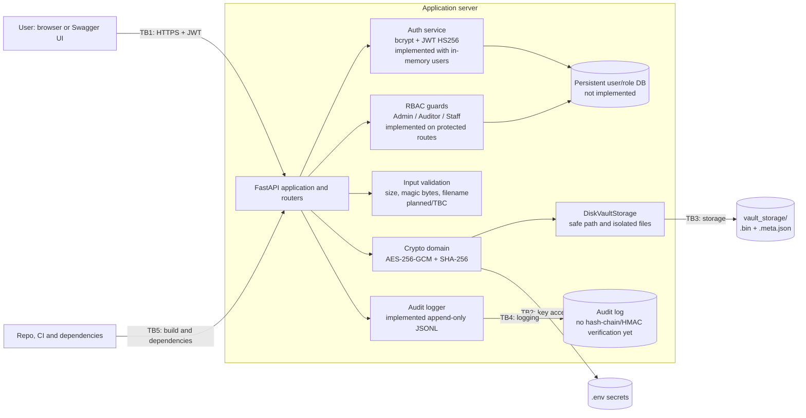
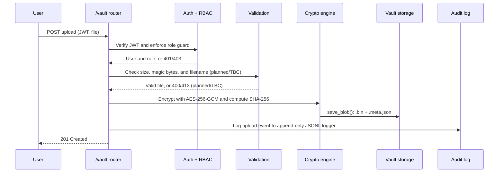
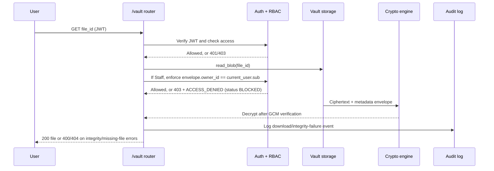

# Architecture — Role-Based Secure Financial Document Vault

| Field | Value |
|---|---|
| Document owner | OhUk Kwon (Lead System Architect & Core Developer) |
| Reviewer | David Williams (Threat Modeling & Technical Documentation Lead) |
| Current version | **v0.1 — Draft** |
| Last updated | 2026-10-23 |
| Linked documents | [`THREAT_MODEL.md`](THREAT_MODEL.md) v1.0 · [`TEST_MATRIX.md`](TEST_MATRIX.md) v0.4 · [`DOCUMENTATION_GUIDE.md`](DOCUMENTATION_GUIDE.md) v0.9 |
| Code baseline | `main` at `96e6e76426ae3db4968bdaaa61389b7f47f4e0dc` |

> This document distinguishes implemented repository components from still-open prototype hardening items.

---

## 1. Overview

The intended vault is a FastAPI backend that allows authenticated users to upload and download financial documents according to a three-tier role model. The current repository implements the crypto and secure-storage foundation plus integrated API delivery: authentication login/JWT issuance, RBAC route guards, vault upload/download routes, telemetry routes, and composition-root dependency wiring.

The current implementation remains a prototype: users are in-memory seed records, there is no persistent user database, audit logging is append-only JSONL without cryptographic hash-chaining/HMAC verification, and file metadata integrity currently relies on plain SHA-256 rather than keyed integrity protection. Trust boundaries TB1–TB5 and expanded threat coverage are defined in [`THREAT_MODEL.md`](THREAT_MODEL.md) §§4 and 6.1.

## 2. Technology Stack

| Layer | Technology | Current status / notes |
|---|---|---|
| API | FastAPI, Swagger UI | `/auth`, `/vault`, and `/audit` routers are mounted in `app/main.py`. `/docs` is exposed for the demo only (F-06). |
| Authentication | bcrypt password hashing; JWT signed with HS256 | Implemented login endpoint and JWT engine. Current user source is in-memory seed data in `app/domains/auth/router.py`. |
| Authorization | Three-tier RBAC: Administrator, Compliance Auditor, General Staff | Implemented route-level role checks via `RequireRoles` in `app/dependencies.py`. |
| Encryption | AES-256-GCM in `app/domains/crypto/aes_engine.py` | Implemented. AES-GCM authenticates ciphertext and rejects modified payloads. |
| Integrity | SHA-256 with constant-time comparison in `app/domains/crypto/hasher.py` | Implemented. HMAC protection of stored hashes remains planned for T2. |
| Metadata model | `EncryptedEnvelope` in `app/domains/vault/models.py` | Implemented: metadata is stored as `.meta.json` envelopes beside each ciphertext. SQLite was planned in the proposal but is not used; a persistent metadata store is future work. |
| File store | `vault_storage/` through `DiskVaultStorage` | Implemented. Stores `{file_id}.bin` ciphertext separately from `{file_id}.meta.json` metadata. |
| Audit log | Append-only JSONL event log | Implemented append-only `FileAuditLogger`; cryptographic tamper-proofing (hash chain/HMAC verification) remains open. |
| Secrets and configuration | `.env`, `.env.example`, `setup.bat`, `app/config.py` | Implemented safeguards: startup rejects invalid/weak secrets; setup does not overwrite an existing `.env` and stops when required secrets are blank. |
| Dependency wiring | `app/dependencies.py` | Implemented composition root for cipher, hasher, storage, JWT, password hasher, audit logger, and RBAC dependencies. |
| Repository and CI governance | `.github/workflows/`, branch settings, CODEOWNERS | Workflow-based documentation review exists; branch protection, CODEOWNERS, action pinning, and MFA require repository inspection (T6/TC-23). |

## 3. Components



| Component | Code location | Responsibility | Status |
|---|---|---|---|
| FastAPI app and configuration | `app/main.py`, `app/config.py` | Application setup, settings, and secret loading | Implemented |
| Crypto engine | `app/domains/crypto/aes_engine.py` | AES-256-GCM encryption and decryption | Implemented |
| Integrity hasher | `app/domains/crypto/hasher.py` | SHA-256 hashing and constant-time digest comparison | Implemented |
| Crypto contracts | `app/domains/crypto/protocols.py` | Interfaces for cipher and hash implementations | Implemented |
| Vault models | `app/domains/vault/models.py` | Validated encrypted-file metadata envelope | Implemented |
| Vault storage contract | `app/domains/vault/protocols.py` | Storage and safe-path interface | Implemented |
| Vault storage adapter | `app/domains/vault/disk_storage.py` | Path confinement, ciphertext persistence, metadata persistence, and reads | Implemented |
| Auth service | `app/domains/auth/` | Password hashing, login, JWT creation, and verification | Implemented (seed-user prototype) |
| RBAC guards | `app/dependencies.py` `RequireRoles` and protected routes | Authorization checks on protected requests | Implemented |
| Input validation | Vault/API route dependencies | File size, type, filename, and request validation | Planned / TBC |
| Audit logger | `app/telemetry/audit_logger.py` | Append-only security-event recording with redaction | Implemented (no cryptographic tamper-proof verification) |
| Routers | `app/domains/*/router.py`, `app/telemetry/router.py` | `/auth`, `/vault`, and `/audit` endpoints | Implemented |
| Composition root | `app/dependencies.py` | Dependency injection and implementation wiring | Implemented |
| Dependency and repository governance | `requirements.txt`, `.github/workflows/`, repository settings | Dependency review, CI gates, branch protection, and workflow ownership | Partial / TBC |

## 4. Implemented Security Foundations

### 4.1 AES-256-GCM

`AesGcmCipherEngine` requires a 32-byte key. The composition root now passes the validated, decoded 32-byte binary key from configuration decoding (instead of truncating the encoded Base64 text). It generates a random 12-byte nonce for each encryption operation and returns the nonce prefixed to the ciphertext and authentication tag. During decryption, an invalid tag raises an error before plaintext is returned. Nonce-uniqueness evidence is recorded in `TEST_MATRIX.md` for TC-17.

### 4.2 SHA-256 Integrity Verification

`Sha256Hasher` computes a SHA-256 digest and uses `hmac.compare_digest` for constant-time comparison. This does not prevent an attacker from replacing both a file and its stored digest; HMAC protection and version records remain planned for T2.

### 4.3 Vault Storage Isolation

`DiskVaultStorage` confines paths to its resolved base directory. It rejects null bytes, canonicalizes untrusted names with `Path.name`, resolves the target path, and verifies that the result remains within the vault directory.

```text
vault_storage/{file_id}.bin
vault_storage/{file_id}.meta.json
```

### 4.4 Configuration and Setup Validation

The current baseline documents and tests the following controls:

- The encryption key is URL-safe Base64 and decodes to exactly 32 bytes for AES-256-GCM.
- `JWT_SECRET_KEY` requires at least 32 bytes.
- Only `HS256` is accepted for JWT configuration.
- `ACCESS_TOKEN_EXPIRE_MINUTES` is limited to 1–15 minutes.
- `ENCRYPTION_KEY` is preferred, with legacy `FERNET_SECRET_KEY` supported as a compatibility fallback.
- `python-dotenv` is an explicit dependency for `dotenv.load_dotenv`.
- `setup.bat` creates `.env` only when absent, does not overwrite an existing file, checks required secrets, validates configuration, and initializes `vault_storage`.

These controls harden configuration and are integrated with implemented authentication, RBAC, vault, and telemetry routes. Prototype limitations remain: no persistent user database, no keyed/hash-chained metadata integrity model, and no cryptographic verification chain for audit logs. Dependency pinning and dependency-audit automation remain open under F-05/F-12 and T5.

## 5. Key Request Flows

The following flows describe the currently implemented request paths and their remaining hardening gaps.

### 5.1 Upload



### 5.2 Download



## 6. RBAC Permission Matrix

This matrix is based on the role definitions in [`THREAT_MODEL.md`](THREAT_MODEL.md) §2. Deny by default. Route-level enforcement exists in the current API, but Admin user-management routes and persistent role storage are not implemented.

| Action | Administrator | Compliance Auditor | General Staff |
|---|---|---|---|
| Create users and assign roles | Planned ✓ | ✗ | ✗ |
| Upload documents | Implemented ✓ | ✗ | Implemented ✓ |
| Download any document | Implemented ✓ | Implemented ✓ read-only | Implemented ✓ only for documents owned by the requesting Staff user |
| Download documents permitted to own role | Implemented ✓ | Implemented ✓ | Implemented ✓ |
| Delete documents | TBC | ✗ | ✗ |
| View audit log | Implemented ✓ | Implemented ✓ | ✗ |
| Delete or edit audit log entries | ✗ | ✗ | ✗ |
| Change configuration | Planned ✓ | ✗ | ✗ |

Current behavior: users are pre-seeded in memory, users cannot self-assign roles through API routes, and route guards enforce role claims from verified JWT payloads. Staff download requests also enforce `envelope.owner_id == current_user.sub`; unauthorized cross-owner requests return `403` and append an `ACCESS_DENIED` audit event with `status: "BLOCKED"`. Persistent database-backed role lookup is not implemented.

## 7. Security Controls Map

| Control | Component | Threats | Findings | Tests | Current status |
|---|---|---|---|---|---|
| bcrypt hashing, lockout, and generic errors | Auth service | S1 | F-05 | TC-01 | Password hashing and generic error handling implemented; lockout/rate-limiting remains planned |
| HS256 fixed in code, strong secret, and short expiry | Configuration/auth | S2, S3, E2 | F-01, F-02, F-07 | TC-02, TC-07, TC-13, TC-18 | Configuration/JWT controls implemented; replay revocation remains planned |
| Deny-by-default RBAC and Staff object-level ownership check | RBAC guards and vault download route | E1, E2, E4 | — | TC-12, TC-13, TC-16, TC-24, TC-23 | Route guards and Staff ownership enforcement are implemented; persistent DB-backed role reload remains planned |
| AES-256-GCM authenticated encryption | Crypto engine | T1, I5, I7 | F-04 | TC-03, TC-15, TC-17 | Implemented; unit evidence is recorded for TC-03, TC-15, and TC-17 |
| HMAC-protected integrity hashes | Crypto engine | T2 | — | TC-04 | Planned |
| Safe path resolution and confinement | Vault storage | I2 | F-08 | TC-08 | Verified with passing vault unit tests |
| Separate ciphertext and metadata storage | Vault storage | I5 | F-09 | TC-15, TC-16 | Storage behavior implemented and unit-tested; integration test exists with no recorded run evidence yet |
| Parameterized queries / ORM | Database access | T4 | — | TC-14 | Planned / TBC |
| Size limit, rate limiting, and magic-byte allowlist | Input validation | D1, D2 | — | TC-10, TC-11 | Planned / TBC |
| Append-only audit log (JSONL) | Audit logger | T3, R1, I8, D3 | — | TC-05, TC-06, TC-19, TC-20 | Implemented append-only logging; cryptographic tamper resistance and verification chain remain planned |
| Keys only in git-ignored `.env`, checked at startup | Configuration | I1, I6, D4 | F-02, F-03, F-04, F-10, F-11 | TC-07, TC-21 | Implemented configuration/setup guardrails; operational key backup and recovery remain planned |
| Dependency review and secure package provenance | Requirements/CI | T5 | F-05, F-12 | TC-22 | Planned / TBC |
| Branch protection and workflow ownership | Repository governance | T6 | — | TC-23 | Not verified; repository settings require inspection |

## 8. Design Decisions

| ID | Decision | Alternatives considered | Reason | Related |
|---|---|---|---|---|
| AD-01 | AES-256-GCM for file encryption | Fernet (AES-CBC + HMAC) | Authenticated encryption in one primitive and alignment with the design specification | T1, F-04 |
| AD-02 | JWT algorithm fixed to HS256 in code | Algorithm from `.env` | Prevents unsupported algorithm selection and algorithm-confusion configuration | S2, F-01 |
| AD-03 | Reload role from the database on each protected request | Trust role claim in JWT | Role changes take effect immediately and edited claims cannot grant access | E2, E4 |
| AD-04 | Store ciphertext and metadata as separate files | Single combined file | Isolates the binary payload and validated metadata envelope | I5, F-09 |
| AD-05 | Use bcrypt for passwords | PBKDF2, Argon2 | Salted and adaptive password hashing; final library choice remains subject to F-05 review | S1, F-05 |
| AD-06 | Use protocol-based domain boundaries | Direct coupling between routers and implementations | Enables replacement and isolated testing of crypto and storage implementations | Architecture / testability |
| AD-07 | Treat repository and CI configuration as a security boundary | Review only application code | Workflow and dependency changes can alter the delivered application; controls are tracked by T5/T6 and TC-22/TC-23 | A7, TB5 |

## 9. Open Architecture Items

Before the final report is exported, confirm:

1. Replace in-memory seed users with persistent user/role storage and secure lifecycle controls.
2. Add file-size limits, magic-byte allowlisting, and rate limiting to upload/auth endpoints.
3. Add cryptographic audit-log tamper verification (hash chain and/or HMAC), plus a verification routine.
4. Add keyed metadata integrity (HMAC or equivalent) and anti-rollback/versioning controls.
5. Define and implement final delete-document and audit-log retention/permissions policy.
6. Confirm repository settings for branch protection, CODEOWNERS, action pinning, and MFA governance.
7. Complete dependency pinning, package replacement, and `pip-audit` integration.
8. Keep architecture claims aligned with `THREAT_MODEL.md` v1.0 and evidence in `TEST_MATRIX.md` v0.4.

## 10. Change Log

| Version | Date | Author | Changes |
|---|---|---|---|
| v0.1 | 2026-10-18 | D. Williams (draft for O. Kwon) | Corrected the architecture draft using current repository paths; separated implemented crypto/storage foundations from planned auth, RBAC, validation, audit, and API components. |
| v0.1 | 2026-10-19 | D. Williams | Synchronized linked-document versions and baseline with threat model v0.5 and documentation guide v0.5; documented configuration-hardening details. |
| v0.1 | 2026-10-19 | D. Williams | Synchronized with threat model v0.6 and test matrix v0.2; added repository/CI boundary coverage, expanded control mappings, and documented remaining dependency, integration, and governance gaps. |
| v0.1 | 2026-10-23 | Copilot | Synchronized architecture claims with current implementation (`main@ac6584d5c5e7bc35baa0a31e04a3a7d4d6c55df5`): marked auth/RBAC/audit/routers/composition wiring implemented, retained prototype limitations (seed users, no persistent user DB, append-only non-hash-chained audit log, plain SHA-256 metadata integrity), and aligned links/open items with threat model v1.0 and test matrix v0.3. |
| v0.1 | 2026-10-23 | Copilot | Synchronized with merged PR #22 and `main@96e6e76426ae3db4968bdaaa61389b7f47f4e0dc`: documented Staff object-level download authorization with denied-access auditing, recorded decoded 32-byte AES key usage in composition wiring, and aligned linked evidence references. |
