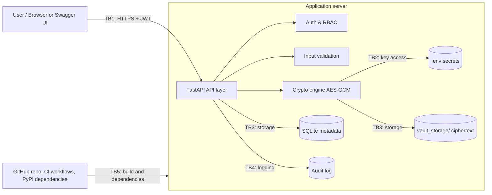

# Threat Model — Role-Based Secure Financial Document Vault

> **Living document.** Updated whenever a module is added or changed. Each version is tracked in Git; see the [Change Log](#11-change-log) and [`DOCUMENTATION_GUIDE.md`](DOCUMENTATION_GUIDE.md).

| Field | Value |
|---|---|
| Document owner | David Williams (Threat Modeling & Technical Documentation Lead) |
| Contributors | OhUk Kwon (Architecture, Crypto, RBAC) · Dhruvi Sorathiya (Validation, Logging, Testing) |
| Current version | **v0.6 — Draft** |
| Last updated | 2026-10-19 |
| Code baseline reviewed | `main` at commit `9cb8b91db2b05257199fb24024de45d0e4225b3b`; crypto engine, hasher, vault storage, configuration hardening, tests, setup, and CI workflows reviewed |
| Methodology | STRIDE per element (§6.1), Likelihood × Impact risk rating before and after mitigation (§5, §6.2) |

---

## 1. Scope

**In scope:** FastAPI backend, JWT authentication and RBAC, file encryption at rest, integrity verification, input validation, audit logging, local storage (SQLite + `vault_storage/`).

**Out of scope:** front-end styling, payment integration, multi-region deployment, host operating-system hardening, physical security.

## 2. System Overview

The vault lets authenticated users upload and download financial documents according to their role. Files are encrypted before being written to disk, integrity is checked on every download, and security-relevant events are written to an audit log.

| Role | Intended permissions |
|---|---|
| Administrator | Manage users and roles; upload and download all documents; no audit-log deletion |
| Compliance Auditor | Read documents and audit records; cannot modify configuration |
| General Staff | Upload and download documents permitted to their role; cannot view audit records |

## 3. Assets

| ID | Asset | Why it matters |
|---|---|---|
| A1 | Financial documents (plaintext) | Confidentiality and integrity of client and company data |
| A2 | Encryption key (`.env`) | Compromise exposes every stored file |
| A3 | JWT signing secret (`.env`) | Compromise allows forging any user and role |
| A4 | User credentials (bcrypt hashes) | Account takeover |
| A5 | File metadata, integrity hashes and user-role records (SQLite) | Basis for access and integrity decisions |
| A6 | Audit log | Accountability and incident investigation |
| A7 | Source code, dependencies and CI workflows | A compromised build delivers attacker code with full application privileges |

### 3.1 Threat Actors

| ID | Actor | Starting access | Motivation | Relevant threats |
|---|---|---|---|---|
| TA1 | External attacker | Network access to the API; no account | Steal or alter financial documents | S1, S2, T4, I2, I3, I4, D1, D2 |
| TA2 | Curious or malicious Staff user | Valid low-privilege account | Read documents outside their role; hide their actions | E1, E2, T4, R1, D1, D2 |
| TA3 | Holder of stolen credentials or token | A real user's password or JWT, or a team member's GitHub account | Act as that user or contributor | S1, S3, T6 |
| TA4 | Malicious insider administrator | Legitimate Admin access | Misuse access; cover tracks | E3, T3, R1 |
| TA5 | Attacker with host or disk access | Stolen disk or backup, or a compromised server | Bulk theft or tampering of stored data | T1, T2, T3, I1, I5, I6, I7, E4 |
| TA6 | Supply-chain attacker | Control of, or a known vulnerability in, a third-party package | Run code inside the application | T5 |

Some threats need no attacker: D4 (key lost) and D3 (log growth) can also happen by accident, so they are rated on likelihood of occurrence rather than attacker skill.

## 4. Trust Boundaries and Data Flow

| Boundary | Between | What crosses it |
|---|---|---|
| TB1 | Untrusted client → API | Credentials, JWTs, uploaded files, filenames |
| TB2 | Application → secrets | Encryption key, JWT secret |
| TB3 | Application → storage | Ciphertext, metadata, integrity hashes, user-role records |
| TB4 | Application → audit log | Security events |
| TB5 | Repository, CI and package index → application | Source code, third-party packages, workflow definitions |

## 5. Risk Rating Method

Likelihood (L) and Impact (I) are each rated 1–3. **Risk = L × I.**

| Score | Level | Action |
|---|---|---|
| 6–9 | **High** | Must be mitigated and tested before the demo |
| 3–4 | **Medium** | Mitigate or justify acceptance |
| 1–2 | **Low** | Document and accept |

- **Likelihood:** 1 = needs insider access or rare skill · 2 = plausible with effort · 3 = easy or common attack
- **Impact:** 1 = minor · 2 = one user or document affected · 3 = many users, regulatory or financial loss
- **Inherent risk** (§6) is rated before mitigation. **Residual risk** (§6.2) is rated assuming the planned mitigation is in place: preventive controls lower Likelihood; detective controls lower Impact.
- A simple 3 × 3 scale was chosen over CVSS or the OWASP Risk Rating Methodology because it is transparent, quick to apply consistently across a small team, and sufficient to rank threats for a prototype.

**Status values:** `Open` (not addressed) · `Planned` (in design) · `Implemented` (in code) · `Verified` (passed a test case recorded in `TEST_MATRIX.md`). The Status column holds one value only; evidence and partial-progress notes go in §6.2.

## 6. STRIDE Threat Register

| ID | STRIDE | Threat | Boundary / Asset | L | I | Risk | Mitigation | Status | Test ID | Demo |
|---|---|---|---|---|---|---|---|---|---|---|
| S1 | Spoofing | Password guessing or credential stuffing on login | TB1 / A4 | 3 | 3 | **High (9)** | bcrypt hashing; login rate limiting / lockout; generic error messages | Planned | TC-01 | Show lockout |
| S2 | Spoofing | Forged JWT (weak secret, `alg: none`, algorithm confusion) | TB1 / A3 | 2 | 3 | **High (6)** | Only `HS256` allowed, JWT secret ≥ 32 bytes and token lifetime 1–15 minutes, enforced in `app/config.py`; JWT issuance and verification with a maintained library in the auth service | Planned | TC-02 | Optional |
| S3 | Spoofing | Stolen JWT replayed (copied from browser storage, logs or Swagger UI) | TB1 / A3 | 2 | 3 | **High (6)** | Short token lifetime (≤ 15 min, enforced in config); tokens never written to logs; HTTPS in deployment; server-side revocation on logout (`jti` denylist) if time allows | Planned | TC-18 | Optional |
| T1 | Tampering | Ciphertext altered on disk | TB3 / A1 | 2 | 3 | **High (6)** | AES-GCM authentication tag rejects modified ciphertext before decryption | Implemented | TC-03 | Show tamper detection |
| T2 | Tampering | File and stored hash both replaced, or older valid version restored (rollback) | TB3 / A5 | 1 | 3 | **Medium (3)** | `Sha256Hasher` currently uses plain SHA-256 with constant-time comparison only; HMAC-protected stored hashes under a separate key plus version records planned. Rollback remains residual | Planned | TC-04 | Optional |
| T3 | Tampering | Audit log entries edited or deleted | TB4 / A6 | 2 | 3 | **High (6)** | Hash-chained, HMAC-signed entries; log verification routine | Planned | TC-05 | Optional |
| T4 | Tampering / Info disclosure | SQL injection through login, search or metadata fields | TB1, TB3 / A4, A5 | 2 | 3 | **High (6)** | Parameterized queries / ORM only; server-side input validation | Planned | TC-14 | Optional |
| T5 | Tampering / Elevation | Vulnerable or malicious third-party package (unpinned versions, typosquatting, known CVEs) runs inside the application | TB5 / A7, A1–A3 | 2 | 3 | **High (6)** | Pin exact versions in `requirements.txt`; replace `python-jose` and `passlib` (F-05); `pip-audit` in CI alongside Bandit; review every dependency change in a PR | Planned | TC-22 | No |
| T6 | Tampering | CI workflow or `main` branch changed to skip security checks or merge unreviewed code (edited workflow, compromised contributor account) | TB5 / A7 | 1 | 3 | **Medium (3)** | Branch protection on `main` requiring a reviewed PR and passing checks; CODEOWNERS covering `.github/workflows/`; third-party actions pinned to a version or commit SHA; no secrets in workflow files; MFA on team GitHub accounts | Open | TC-23 | No |
| R1 | Repudiation | User denies uploading, downloading or deleting a file | TB4 / A6 | 2 | 2 | **Medium (4)** | Log user ID, role, timestamp, IP and action (accountability, not legal non-repudiation) | Planned | TC-06 | Show audit log |
| I1 | Info disclosure | Encryption or JWT key exposed through the repository (committed `.env`, key in code) | TB2 / A2, A3 | 2 | 3 | **High (6)** | `.env` ignored in `.gitignore`; `ENCRYPTION_KEY` (legacy `FERNET_SECRET_KEY` fallback) must be URL-safe Base64 decoding to exactly 32 bytes; `JWT_SECRET_KEY` ≥ 32 bytes; `.env` loading dependency declared. Operational secret management (vault/HSM, rotation governance) is outside prototype scope | Implemented | TC-07 | Describe only |
| I2 | Info disclosure | Path traversal via filename (`../../`) | TB1 / A1 | 2 | 3 | **High (6)** | `DiskVaultStorage.resolve_safe_path()` rejects null bytes, strips directory components via `Path(...).name`, resolves against the vault base path, and enforces confinement with `is_relative_to()` in `app/domains/vault/disk_storage.py` | Implemented | TC-08 | Show rejection |
| I3 | Info disclosure | Data or tokens intercepted in transit | TB1 / A1, A3 | 2 | 3 | **High (6)** | HTTPS/TLS (documented as deployment requirement for demo) | Planned | — | No |
| I4 | Info disclosure | Error messages or API docs reveal internals | TB1 | 2 | 1 | **Low (2)** | Generic errors; debug off; disable `/docs` in production | Open | TC-09 | No |
| I5 | Info disclosure | Stolen disk or backup exposes stored documents | TB3 / A1 | 2 | 3 | **High (6)** | Encryption foundation uses AES-GCM; ciphertext and metadata are stored separately (`{file_id}.bin` + `{file_id}.meta.json`) through `save_blob()` / `read_blob()` in `app/domains/vault/disk_storage.py`, with envelope schema in `app/domains/vault/models.py`. Complete upload/download integration remains TBC | Implemented | TC-15, TC-16 | Show ciphertext on disk |
| I6 | Info disclosure | Server compromise reads the single master key, exposing every file | TB2 / A2 | 1 | 3 | **Medium (3) — residual** | Key in environment, never in repo or DB; rotation plan; production would use a key vault / HSM | Planned | TC-07 | Describe only |
| I7 | Info disclosure / Tampering | AES-GCM nonce reused under the same key (fixed, counter-reset or predictable nonce), breaking confidentiality and authenticity | TB2, TB3 / A1, A2 | 2 | 3 | **High (6)** | Fresh random 96-bit nonce from a CSPRNG (`os.urandom(12)` / `secrets`) for every encryption, stored with the ciphertext; never derived from file ID or time; unit test that repeated encryptions of the same file produce different nonces; documented key-usage limit | Open | TC-17 | No |
| I8 | Info disclosure | Audit log exposes sensitive data (passwords on failed login, tokens, document contents) | TB4 / A6 | 2 | 2 | **Medium (4)** | Log event metadata only: never passwords, tokens or file contents; audit log readable by Auditor and Admin only (RBAC) | Planned | TC-19 | No |
| D1 | Denial of service | Oversized or repeated uploads exhaust disk/CPU | TB1 | 2 | 2 | **Medium (4)** | File-size limit; request rate limiting | Planned | TC-10 | Optional |
| D2 | DoS / Tampering | Malicious file disguised by extension (e.g., `.exe` renamed `.pdf`) | TB1 / A1 | 2 | 2 | **Medium (4)** | Magic-byte allowlist; files never executed | Planned | TC-11 | Show rejection |
| D3 | Denial of service | Audit log flooded by repeated failed requests until disk fills or real events are buried | TB4 / A6 | 2 | 2 | **Medium (4)** | Rate limiting shared with D1 and S1; log size monitoring; rotation that preserves the hash chain across files | Planned | TC-20 | No |
| D4 | Denial of service | Encryption key lost, overwritten or corrupted, making every stored file permanently unrecoverable | TB2 / A2, A1 | 2 | 3 | **High (6)** | Setup does not overwrite an existing `.env`, but key backup, recovery procedure, and startup canary validation are not implemented | Planned | TC-21 | Describe only |
| E1 | Elevation | User requests another role's file by ID (IDOR) | TB1 / A1 | 3 | 3 | **High (9)** | Server-side RBAC check on every request; deny by default | Planned | TC-12, TC-16 | Show 403 |
| E2 | Elevation | User edits role claim in JWT | TB1 / A3 | 2 | 3 | **High (6)** | Signature verification; reload role from database per request | Planned | TC-13 | Optional |
| E3 | Elevation | Insider admin misuses legitimate access | Whole system | 1 | 3 | **Medium (3) — residual** | Least privilege; separate key and storage duties; audit review | Planned | — | No |
| E4 | Elevation / Tampering | User-role records edited directly in the SQLite file to self-promote | TB3 / A5 | 1 | 3 | **Medium (3)** | SQLite file readable and writable only by the application service account; roles changed only through the Admin API; every role change written to the audit log | Open | — | No |

**Summary (v0.6):** 26 threats across all six STRIDE categories; 14 High, 10 Medium, 1 Low before mitigation.
**Status (v0.6):** 4 Implemented (T1, I1, I2, I5) · 0 Verified · 18 Planned · 4 Open (T6, I4, I7, E4).

### 6.1 STRIDE-per-Element Coverage

Each element of the data flow diagram (§4) is checked against the STRIDE categories that apply to its type. Cells list the threat IDs that cover it; `—` means no specific threat was identified, with the reason in the Notes column; `n/a` means the category does not apply to that element type.

| Element | Type | S | T | R | I | D | E | Notes |
|---|---|---|---|---|---|---|---|---|
| User / browser | External entity | S1, S3 | n/a | R1 | n/a | n/a | n/a | — |
| Client → API (TB1) | Data flow | n/a | I3 | n/a | I3 | D1 | n/a | Tampering in transit covered by the same TLS requirement as I3 |
| FastAPI API layer | Process | S2, S3 | T4 | R1 | I4 | D1, D2 | E1 | — |
| Auth & RBAC | Process | S1, S2 | E2 | R1 | I4 | — | E1, E2, E4 | DoS on login handled by S1 rate limiting |
| Crypto engine | Process | — | T1, I7 | — | I6, I7 | — | No user identity, actions or privileges at this layer |
| `.env` secrets | Data store | n/a | — | n/a | I1, I6 | D4 | n/a | Tampering with keys requires host access and would cause decryption failures, not silent compromise |
| SQLite metadata | Data store | n/a | T2, E4 | n/a | T4 | — | n/a | Database size bounded by D1 upload limits |
| `vault_storage/` | Data store | n/a | T1, T2 | n/a | I2, I5 | D1 | n/a | — |
| Audit log | Data store | n/a | T3 | R1 | I8 | D3 | n/a | Audit log is a store whose purpose is accountability, so R is applied |
| Repo, CI and dependencies (TB5) | External process | T6 | T5, T6 | — | — | — | T5 | Contributor spoofing via a stolen GitHub account is covered by T6; no secrets are stored in workflows; an unavailable package index delays builds but not the running vault |

E3 (insider misuse of legitimate access) applies across all elements, so it is not assigned to one row.

### 6.2 Mitigation Tracking and Residual Risk

Residual risk assumes the listed mitigation is implemented. Owners follow the work breakdown (`wbs.md`): **Build** implements the control; **Verify** runs and records the test.

| ID | Build | Verify | Target | Evidence | Residual L × I | Residual risk |
|---|---|---|---|---|---|---|
| S1 | O. Kwon | D. Sorathiya | Phase 3 (10/19) | — | 1 × 3 | Medium (3) |
| S2 | O. Kwon | D. Sorathiya | Phase 3 (10/19) | Config controls implemented in `app/config.py` (F-01, F-02, F-07); `tests/unit/test_config.py`. Full JWT flow pending | 1 × 3 | Medium (3) |
| S3 | O. Kwon | D. Sorathiya | Phase 3 (10/19) | Token lifetime cap implemented (F-07) | 1 × 3 | Medium (3) |
| T1 | O. Kwon | D. Sorathiya | Phase 2 — record run | `tests/unit/test_crypto.py::test_tamper_detection` | 2 × 2 | Medium (4) — modification detected; one document unavailable |
| T2 | O. Kwon | D. Sorathiya | Phase 4 (10/21) | — | 1 × 3 | Medium (3) — rollback remains (§8) |
| T3 | O. Kwon | D. Sorathiya | Phase 4 (10/21) | — | 2 × 2 | Medium (4) — edits detected, not prevented |
| T4 | O. Kwon | D. Sorathiya | Phase 3–4 | — | 1 × 3 | Medium (3) |
| T5 | O. Kwon | D. Sorathiya | Before Phase 3 auth PR merges | Bandit in `code-quality.yml`; F-05 open; `setup.bat` installs unpinned requirements and upgrades pip (F-12) | 1 × 3 | Medium (3) |
| T6 | D. Williams (repository settings, with team) | D. Sorathiya | Phase 4 (10/21) | Threat-model review workflow enforces doc updates; branch protection status to confirm | 1 × 2 | Low (2) |
| R1 | O. Kwon | D. Sorathiya | Phase 4 (10/21) | — | 1 × 2 | Low (2) |
| I1 | O. Kwon | D. Sorathiya | Done — record run | `.gitignore`; `app/config.py` validation (F-02, F-03, F-04, F-10); `tests/unit/test_config.py` | 1 × 3 | Medium (3) |
| I2 | O. Kwon | D. Sorathiya | Done — record run | `tests/unit/test_vault.py::test_directory_traversal_mitigation`, `::test_null_byte_injection_blocked` (F-08) | 1 × 3 | Medium (3) |
| I3 | D. Williams (document) | — | Report | Deployment requirement (§9) | 2 × 3 local demo / 1 × 3 with TLS | High (6) for local demo, accepted; Medium (3) when deployed |
| I4 | O. Kwon | D. Sorathiya | Phase 4 (10/21) | `/docs` accepted for demo (F-06) | 1 × 1 | Low (1) |
| I5 | O. Kwon | D. Sorathiya | Done — record run; E2E in Phase 4 | `tests/unit/test_vault.py::test_envelope_and_blob_storage_roundtrip`, `::test_nonexistent_blob_read_raises` (F-09) | 1 × 3 | Medium (3) — complete integration remains TBC |
| I6 | O. Kwon | — | Report | Key in environment only | 1 × 3 | Medium (3) — highest residual (§8) |
| I7 | O. Kwon | D. Sorathiya | Before Phase 4 — confirm nonce generation in `aes_engine.py` | — | 1 × 3 | Medium (3) |
| I8 | O. Kwon | D. Sorathiya | Phase 4 (10/21) | — | 1 × 2 | Low (2) |
| D1 | O. Kwon | D. Sorathiya | Phase 4 (10/21) | — | 1 × 2 | Low (2) |
| D2 | O. Kwon | D. Sorathiya | Phase 4 (10/21) | — | 1 × 2 | Low (2) |
| D3 | O. Kwon | D. Sorathiya | Phase 4 (10/21) | — | 1 × 2 | Low (2) |
| D4 | O. Kwon | D. Sorathiya | Phase 4 (10/21) | `setup.bat` does not overwrite an existing `.env`; key backup and startup canary check pending | 1 × 3 | Medium (3) |
| E1 | O. Kwon | D. Sorathiya | Phase 3 (10/19) | — | 1 × 3 | Medium (3) |
| E2 | O. Kwon | D. Sorathiya | Phase 3 (10/19) | — | 1 × 3 | Medium (3) |
| E3 | Team | — | Report | Logging and least privilege | 1 × 3 | Medium (3) — residual (§8) |
| E4 | O. Kwon | — | Phase 4 (10/21) | — | 1 × 3 | Medium (3) — host trusted (§9) |

Any High threat whose mitigation is not implemented and tested by the final dry run (10/23) is moved to §8 with a written justification before the `v1.0` export.

## 7. Code Review Findings (Baseline: `main@9cb8b91db2b05257199fb24024de45d0e4225b3b`)

| ID | File | Finding | Related threat | Severity | Status |
|---|---|---|---|---|---|
| F-01 | `config.py` | JWT configuration enforces `HS256` and rejects other values | S2 | High | Implemented |
| F-02 | `config.py` | Key format and strength validation implemented: encryption key must decode to exactly 32 bytes and JWT secret must be at least 32 bytes | S2, I1 | Medium | Implemented |
| F-03 | Repository | `.env` exclusion is present in `.gitignore`; keep this repository control enforced | I1 | High | Implemented |
| F-04 | `config.py`, `.env.example` | AES key setting uses `ENCRYPTION_KEY` with legacy `FERNET_SECRET_KEY` fallback for compatibility; validation messages describe AES-256-GCM key requirements | I1 | Low | Implemented |
| F-05 | `requirements.txt` | `python-jose>=3.3.0` permits versions with published JWT vulnerabilities; `passlib` unmaintained; versions not pinned | S2, S1, T5 | Medium | Open |
| F-06 | `main.py` | `/docs` and `/redoc` always exposed | I4 | Low | Accepted for demo |
| F-07 | `config.py` | Access-token lifetime is constrained to 1–15 minutes | S2, S3 | Low | Implemented |
| F-08 | `app/domains/vault/disk_storage.py` | Path traversal hardening implemented: null-byte rejection, safe filename canonicalization, and base-directory confinement checks | I2 | High | Implemented (evidence: `tests/unit/test_vault.py`) |
| F-09 | `app/domains/vault/disk_storage.py`, `app/domains/vault/models.py` | Vault storage isolation implemented: ciphertext blob and metadata envelope are stored as separate artifacts and validated on read | I5 | High | Implemented (evidence: `tests/unit/test_vault.py`) |
| F-10 | `requirements.txt`, `config.py` | `python-dotenv` dependency is explicitly declared, matching configuration and setup expectations | I1 | Medium | Implemented |
| F-11 | `setup.bat` | `.env` is created from `.env.example` only when absent and is never overwritten; keys are not auto-generated; setup stops if secrets are empty and runs configuration validation | D4, I1 | Medium | Implemented |
| F-12 | `setup.bat`, `requirements.txt` | Installs dependency ranges without pins or hashes and upgrades pip to the latest release, so each setup can pull different package versions | T5 | Medium | Open |

## 8. Residual Risks

| Risk | Why it remains | Justification |
|---|---|---|
| Rollback of an older valid file version (T2) | Integrity checks confirm a file is genuine, not that it is the latest version | Known open problem in research; out of scope for prototype |
| Master key compromise (I6) — **highest residual risk** | Prototype keeps one key in `.env` on the same host as the data; no HSM | Production would use a key vault/HSM and per-file keys wrapped by a master key |
| Insider misuse (E3) | Authorized users can misuse legitimate access | Mitigated by logging and least privilege, not eliminated |
| Interception in transit during the local demo (I3) | The demo runs over local HTTP without TLS | Demo traffic stays on one machine; TLS is a documented deployment requirement (§9) |
| Direct database tampering by a host-level attacker (E4) | Anyone controlling the host can edit SQLite records | Host is assumed trusted (§9); role changes are intended to be audited |

## 9. Assumptions

- The host operating system and Python runtime are trusted and patched.
- The demonstration runs locally; HTTPS is documented as a deployment requirement.
- Users are pre-registered by an Administrator (no self-registration).
- MFA and per-file key wrapping are **not** in the current build; if added later, new threats and tests are added here. Otherwise they are listed as future work in the report.

## 10. ID Conventions

- Threats use STRIDE-letter IDs (S1, T1, R1, I1, D1, E1); findings use F-01…; tests use TC-01…; threat actors use TA1….
- The same IDs are used in the report, slides, test matrix and demo script.
- The earlier role workbook (Sep 30) used T1–T12 / TC1–TC12; those IDs are **superseded** by this register.
- Tests added in v0.6: TC-16 (end-to-end login → upload → role-based download), TC-17 (nonce uniqueness), TC-18 (token replay / revocation), TC-19 (audit log content), TC-20 (audit log flooding), TC-21 (key loss: wrong or missing key detected at startup and setup never overwrites `.env`), TC-22 (dependency audit: versions pinned and `pip-audit` clean), TC-23 (repository inspection: branch protection and CODEOWNERS for workflows). These proposed tests must be added to `TEST_MATRIX.md` before they count as formal coverage.

## 11. Change Log

| Version | Date | Author | Changes |
|---|---|---|---|
| v0.1 | 2026-10-12 | D. Williams | Initial draft: scope, assets, trust boundaries, 15 STRIDE threats, scaffold code review findings F-01 to F-07 |
| v0.2 | 2026-10-12 | D. Williams | Risk bands aligned to 6–9 High / 3–4 Medium / 1–2 Low and scores shown; added T4 (SQL injection), I5 (stolen disk/backup), I6 (master key compromise); I1 narrowed to repository exposure; added Demo column, L/I definitions and ID conventions; tests TC-14, TC-15 added |
| v0.3 | 2026-10-18 | D. Williams | Consolidated CI/security governance notes: documented Ruff/Bandit controls plus merged threat-model review workflow and vault mitigations for I2/I5 with unit-test evidence references |
| v0.4 | 2026-10-19 | D. Williams | Reconciled threat model structure and evidence references during pre-merge review of security-hardening changes; retained open configuration items pending merged baseline confirmation |
| v0.5 | 2026-10-19 | D. Williams | Synchronized with merged security hardening on `main@9cb8b91db2b05257199fb24024de45d0e4225b3b`; removed duplicate metadata rows, updated S2/I1 wording, and marked implemented configuration findings while retaining remaining open/planned items |
| v0.6 | 2026-10-19 | D. Williams | Best-practice review: added threat actors, STRIDE-per-element coverage, supply-chain/CI/key-loss/database-tampering threats, mitigation tracking, residual-risk analysis, and proposed tests TC-16 through TC-23; corrected risk totals and reconciled setup claims with the current implementation. |

## 12. Review Triggers

Update this document (and bump the version) when:

1. A new module is merged (auth, vault, crypto, audit logger).
2. A finding or threat changes status (e.g., Planned → Implemented → Verified).
3. A test case passes or fails.
4. Before each submission milestone (report draft, final report, presentation).

## 13. Automated CI Controls (Code Quality and Security)

The `code-quality.yml` workflow adds automated checks for:

- **Ruff** for Python linting and formatting consistency.
- **Bandit** for common insecure Python coding patterns.

These controls complement the existing `threat-model-review.yml` workflow, which enforces documentation updates when security-sensitive project files change. Ruff and Bandit reduce implementation risk, but they do **not** replace threat modeling, test coverage, or manual security review.
