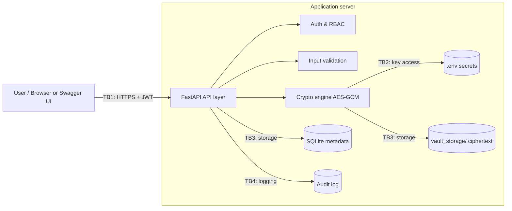

# Threat Model — Role-Based Secure Financial Document Vault

> **Living document.** Updated whenever a module is added or changed. Each version is tracked in Git; see the [Change Log](#11-change-log) and [`DOCUMENTATION_GUIDE.md`](DOCUMENTATION_GUIDE.md).

| Field | Value |
|---|---|
| Document owner | David Williams (Threat Modeling & Technical Documentation Lead) |
| Contributors | OhUk Kwon (Architecture, Crypto, RBAC) · Dhruvi Sorathiya (Validation, Logging, Testing) |
| Current version | **v0.4 — Draft** |
| Last updated | 2026-10-18 |
| Code baseline reviewed | Current scaffold + security setup/config hardening (`app/main.py`, `app/config.py`, `.env.example`, `requirements.txt`, `setup.bat`) |
| Methodology | STRIDE per component, Likelihood × Impact risk rating |

---

## 1. Scope

**In scope:** FastAPI backend, JWT authentication and RBAC, file encryption at rest, integrity verification, input validation, audit logging, local storage (SQLite + `vault_storage/`).

**Out of scope:** front-end styling, payment integration, multi-region deployment, host operating-system hardening, physical security.

## 2. System Overview

The vault lets authenticated users upload and download financial documents according to their role. Files are encrypted before being written to disk, integrity is checked on every download, and security-relevant events are written to an audit log.

| Role | Intended permissions |
|---|---|
| Administrator | Manage users and roles; upload and download all documents; no audit-log deletion |
| Compliance Auditor | Read documents and audit records; cannot modify configuration |
| General Staff | Upload and download documents permitted to their role; cannot view audit records |

## 3. Assets

| ID | Asset | Why it matters |
|---|---|---|
| A1 | Financial documents (plaintext) | Confidentiality and integrity of client and company data |
| A2 | Encryption key (`.env`) | Compromise exposes every stored file |
| A3 | JWT signing secret (`.env`) | Compromise allows forging any user and role |
| A4 | User credentials (bcrypt hashes) | Account takeover |
| A5 | File metadata and integrity hashes (SQLite) | Basis for access and integrity decisions |
| A6 | Audit log | Accountability and incident investigation |

## 4. Trust Boundaries and Data Flow

| Boundary | Between | What crosses it |
|---|---|---|
| TB1 | Untrusted client → API | Credentials, JWTs, uploaded files, filenames |
| TB2 | Application → secrets | Encryption key, JWT secret |
| TB3 | Application → storage | Ciphertext, metadata, integrity hashes |
| TB4 | Application → audit log | Security events |

## 5. Risk Rating Method

Likelihood (L) and Impact (I) are each rated 1–3. **Risk = L × I.**

| Score | Level | Action |
|---|---|---|
| 6–9 | **High** | Must be mitigated and tested before the demo |
| 3–4 | **Medium** | Mitigate or justify acceptance |
| 1–2 | **Low** | Document and accept |

- **Likelihood:** 1 = needs insider access or rare skill · 2 = plausible with effort · 3 = easy or common attack
- **Impact:** 1 = minor · 2 = one user or document affected · 3 = many users, regulatory or financial loss

**Status values:** `Open` (not addressed) · `Planned` (in design) · `Implemented` (in code) · `Verified` (passed a test case).

## 6. STRIDE Threat Register

| ID | STRIDE | Threat | Boundary / Asset | L | I | Risk | Mitigation | Status | Test ID | Demo |
|---|---|---|---|---|---|---|---|---|---|---|
| S1 | Spoofing | Password guessing or credential stuffing on login | TB1 / A4 | 3 | 3 | **High (9)** | bcrypt hashing; login rate limiting / lockout; generic error messages | Planned | TC-01 | Show lockout |
| S2 | Spoofing | Forged JWT (weak secret, `alg: none`, algorithm confusion) | TB1 / A3 | 2 | 3 | **High (6)** | Algorithm fixed in code (HS256, not from `.env`); secret ≥ 32 bytes; short expiry; maintained JWT library | Planned (config controls implemented; full auth flow still TBC, see F-05) | TC-02 | Optional |
| T1 | Tampering | Ciphertext altered on disk | TB3 / A1 | 2 | 3 | **High (6)** | AES-GCM authentication tag rejects modified ciphertext before decryption | Planned | TC-03 | Show tamper detection |
| T2 | Tampering | File and stored hash both replaced, or older valid version restored (rollback) | TB3 / A5 | 1 | 3 | **Medium (3)** | Protect hash with HMAC under a separate key; version records. Rollback remains residual | Planned | TC-04 | Optional |
| T3 | Tampering | Audit log entries edited or deleted | TB4 / A6 | 2 | 3 | **High (6)** | Hash-chained, HMAC-signed entries; log verification routine | Planned | TC-05 | Optional |
| T4 | Tampering / Info disclosure | SQL injection through login, search or metadata fields | TB1, TB3 / A4, A5 | 2 | 3 | **High (6)** | Parameterized queries / ORM only; server-side input validation | Planned | TC-14 | Optional |
| R1 | Repudiation | User denies uploading, downloading or deleting a file | TB4 / A6 | 2 | 2 | **Medium (4)** | Log user ID, role, timestamp, IP and action (accountability, not legal non-repudiation) | Planned | TC-06 | Show audit log |
| I1 | Info disclosure | Encryption or JWT key exposed through the repository (committed `.env`, key in code) | TB2 / A2, A3 | 2 | 3 | **High (6)** | Keys only in environment; `.env` in `.gitignore`; key-format and strength checks at startup | Verified (TC-07 pass: `.env` untracked + configuration validation tests) | TC-07 | Describe only |
| I2 | Info disclosure | Path traversal via filename (`../../`) | TB1 / A1 | 2 | 3 | **High (6)** | `DiskVaultStorage.resolve_safe_path()` rejects null bytes, strips directory components via `Path(...).name`, resolves against vault base path, and enforces confinement with `is_relative_to()` in `app/domains/vault/disk_storage.py` | Verified (TC-08 pass in `tests/unit/test_vault.py`) | TC-08 | Show rejection |
| I3 | Info disclosure | Data or tokens intercepted in transit | TB1 / A1, A3 | 2 | 3 | **High (6)** | HTTPS/TLS (documented as deployment requirement for demo) | Planned | — | No |
| I4 | Info disclosure | Error messages or API docs reveal internals | TB1 | 2 | 1 | **Low (2)** | Generic errors; debug off; disable `/docs` in production | Open (see F-06) | TC-09 | No |
| I5 | Info disclosure | Stolen disk or backup exposes stored documents | TB3 / A1 | 2 | 3 | **High (6)** | Isolated vault persistence stores ciphertext and metadata separately (`{file_id}.bin` + `{file_id}.meta.json`) through `save_blob()` / `read_blob()` in `app/domains/vault/disk_storage.py`, with envelope schema in `app/domains/vault/models.py` | Verified for storage isolation (TC-15 pass); E2E residual coverage remains planned via TC-16 | TC-15 | Show ciphertext on disk |
| I6 | Info disclosure | Server compromise reads the single master key, exposing every file | TB2 / A2 | 1 | 3 | **Medium (3) — residual** | Key in environment, never in repo or DB; rotation plan; production would use a key vault / HSM | Planned | TC-07 | Describe only |
| D1 | Denial of service | Oversized or repeated uploads exhaust disk/CPU | TB1 | 2 | 2 | **Medium (4)** | File-size limit; request rate limiting | Planned | TC-10 | Optional |
| D2 | DoS / Tampering | Malicious file disguised by extension (e.g., `.exe` renamed `.pdf`) | TB1 / A1 | 2 | 2 | **Medium (4)** | Magic-byte allowlist; files never executed | Planned | TC-11 | Show rejection |
| E1 | Elevation | User requests another role's file by ID (IDOR) | TB1 / A1 | 3 | 3 | **High (9)** | Server-side RBAC check on every request; deny by default | Planned | TC-12 | Show 403 |
| E2 | Elevation | User edits role claim in JWT | TB1 / A3 | 2 | 3 | **High (6)** | Signature verification; reload role from database per request | Planned | TC-13 | Optional |
| E3 | Elevation | Insider admin misuses legitimate access | Whole system | 1 | 3 | **Medium (3) — residual** | Least privilege; separate key and storage duties; audit review | Planned | — | No |

**Summary (v0.3):** 18 threats across all six STRIDE categories; 11 High, 6 Medium, 1 Low before mitigation.

## 7. Code Review Findings (Baseline: Initial Scaffold + Vault Storage Updates)

| ID | File | Finding | Related threat | Severity | Status |
|---|---|---|---|---|---|
| F-01 | `config.py` | JWT algorithm must be fixed to `HS256` in code and reject non-HS256 configuration | S2 | High | Implemented in `app/config.py`; auth-module token workflow tests remain planned |
| F-02 | `config.py` | Secret validation must enforce encryption-key decode/length and JWT secret minimum length | S2, I1 | Medium | Implemented in `app/config.py`; test evidence tracked in TC-07 |
| F-03 | Repository | `.env` must stay untracked and git-ignored while setup blocks empty required secrets | I1 | High | Implemented (`.gitignore` + setup/config checks) |
| F-04 | `config.py` | Legacy `FERNET_SECRET_KEY` naming mismatch should transition safely to AES-appropriate naming | I1 | Low | Implemented with backward-compatible `ENCRYPTION_KEY` primary + legacy fallback |
| F-05 | `requirements.txt` | `python-jose>=3.3.0` permits versions with published JWT vulnerabilities; `passlib` unmaintained; versions not pinned | S2, S1 | Medium | Open |
| F-06 | `main.py` | `/docs` and `/redoc` always exposed | I4 | Low | Accepted for demo |
| F-07 | `config.py` | Access-token lifetime should be constrained to a short financial-context window | S2 | Low | Implemented (`ACCESS_TOKEN_EXPIRE_MINUTES` constrained to 1–15) |
| F-08 | `app/domains/vault/disk_storage.py` | Path traversal hardening implemented: null-byte rejection, safe filename canonicalization, and base-directory confinement checks | I2 | High | Implemented (evidence: `tests/unit/test_vault.py`) |
| F-09 | `app/domains/vault/disk_storage.py`, `app/domains/vault/models.py` | Vault storage isolation implemented: ciphertext blob and metadata envelope are stored as separate artifacts and validated on read | I5 | High | Implemented (evidence: `tests/unit/test_vault.py`) |

## 8. Residual Risks

| Risk | Why it remains | Justification |
|---|---|---|
| Rollback of an older valid file version (T2) | Integrity checks confirm a file is genuine, not that it is the latest version | Known open problem in research; out of scope for prototype |
| Master key compromise (I6) — **highest residual risk** | Prototype keeps one key in `.env` on the same host as the data; no HSM | Production would use a key vault/HSM and per-file keys wrapped by a master key |
| Insider misuse (E3) | Authorized users can misuse legitimate access | Mitigated by logging and least privilege, not eliminated |

## 9. Assumptions

- The host operating system and Python runtime are trusted and patched.
- The demonstration runs locally; HTTPS is documented as a deployment requirement.
- Users are pre-registered by an Administrator (no self-registration).
- MFA and per-file key wrapping are **not** in the current build; if added later, new threats and tests are added here. Otherwise they are listed as future work in the report.

## 10. ID Conventions

- Threats use STRIDE-letter IDs (S1, T1, R1, I1, D1, E1); findings use F-01…; tests use TC-01….
- The same IDs are used in the report, slides, test matrix and demo script.
- The earlier role workbook (Sep 30) used T1–T12 / TC1–TC12; those IDs are **superseded** by this register.

## 11. Change Log

| Version | Date | Author | Changes |
|---|---|---|---|
| v0.1 | 2026-10-12 | D. Williams | Initial draft: scope, assets, trust boundaries, 15 STRIDE threats, scaffold code review findings F-01 to F-07 |
| v0.2 | 2026-10-12 | D. Williams | Risk bands aligned to 6–9 High / 3–4 Medium / 1–2 Low and scores shown; added T4 (SQL injection), I5 (stolen disk/backup), I6 (master key compromise); I1 narrowed to repository exposure; added Demo column, L/I definitions and ID conventions; tests TC-14, TC-15 added |
| v0.3 | 2026-10-17 | D. Williams | Added automated controls section documenting Ruff and Bandit checks in CI and how they complement threat-model review governance |
| v0.3 | 2026-10-18 | D. Williams | Documented merged security updates: PR #4 threat-model review enforcement workflow (`.github/workflows/threat-model-review.yml`) and PR #5 vault mitigations for I2 path traversal hardening plus I5 ciphertext/blob and metadata envelope storage isolation, with unit-test evidence references |
| v0.4 | 2026-10-18 | D. Williams | Updated configuration/setup findings after hardening `app/config.py`, `.env.example`, `requirements.txt`, and `setup.bat`: fixed HS256 enforcement, secret strength/format checks, token TTL bounds, backward-compatible encryption-key naming transition, and test-evidence updates for TC-07/TC-08/TC-15. |

## 12. Review Triggers

Update this document (and bump the version) when:

1. A new module is merged (auth, vault, crypto, audit logger).
2. A finding or threat changes status (e.g., Planned → Implemented → Verified).
3. A test case passes or fails.
4. Before each submission milestone (report draft, final report, presentation).

## 13. Automated CI Controls (Code Quality and Security)

The `code-quality.yml` workflow adds automated checks for:

- **Ruff** for Python linting and formatting consistency.
- **Bandit** for common insecure Python coding patterns.

These controls complement the existing `threat-model-review.yml` workflow, which enforces documentation updates when security-sensitive project files change. Ruff and Bandit reduce implementation risk, but they do **not** replace threat modeling, test coverage, or manual security review.
